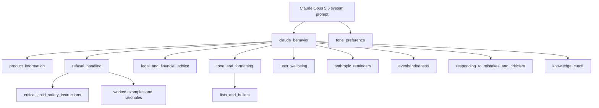
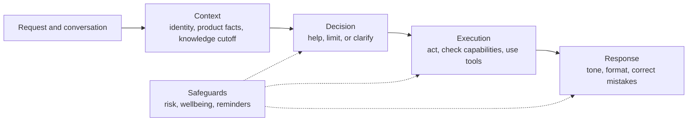

# What Claude Opus System Prompts Teach About Agent Design

In July 2024, Anthropic published the Opus 3 system prompt as one paragraph. A system prompt is a set of rules for a chat program. The Opus 3 prompt named Claude, gave its knowledge limit, and listed a few answer rules. By September 2026, the Opus 5.5 prompt read like a short guide. It had sections for product facts, safety decisions, health, tone, and hard cases.

I compared 12 dated Opus prompts in the [Anthropic release notes for system prompts](https://platform.claude.com/docs/en/release-notes/system-prompts/overview). The main change was the added guidance for decisions. The prompts explain when Claude can help, ask a question, use a tool, or refuse. A tool is a feature that lets Claude search or act. The prompts also explain how Claude can handle a mistake and continue the conversation.

Anthropic publishes these prompts for Claude on the web and in its apps. Anthropic says that they do not apply to the Claude API. The pages do not show every rule that guides Claude in use. They also do not prove that a text change improved model behavior. I retrieved the pages on October 23, 2026.

## The architecture: from description to decisions

The [Opus 3 prompt](https://platform.claude.com/docs/en/release-notes/system-prompts/claude-opus-3) is one block of prose. The [Opus 4.5 prompt](https://platform.claude.com/docs/en/release-notes/system-prompts/claude-opus-4-5) uses named sections. Figure 1 maps the sections in Opus 5.5. This map shows only the public text. It does not show every rule Claude follows.

Figure 1 maps the named sections in Opus 5.5. Figure 2 groups the sections by their job. Together, they show how the prompt gives context, guides a choice, and shapes an answer.

_Figure 1: Sections in the [Claude Opus 5.5 prompt](https://platform.claude.com/docs/en/release-notes/system-prompts/claude-opus-5-5), retrieved October 23, 2026. Child safety and examples are part of refusal handling. Tone preference sits outside the main behavior section._

The sections have different jobs. A knowledge cutoff is the date up to which a model learned facts. This date helps Claude avoid treating old facts as current. Tool rules tell Claude to look for tools before it says that it cannot act. Style rules guide the final answer. Figure 2 shows how these jobs fit together.

_Figure 2: A way to read the Opus prompts. Opus 4.7 and Opus 4.8 give rules for tool use. Safety rules can guide choices across the conversation._

The sections change between versions. [Opus 4.7](https://platform.claude.com/docs/en/release-notes/system-prompts/claude-opus-4-7) tells Claude when to act or ask. It also tells Claude to look for tools and finish each task. [Opus 4.8](https://platform.claude.com/docs/en/release-notes/system-prompts/claude-opus-4-8) adds a tool search section. The published [Opus 5.5 prompt](https://platform.claude.com/docs/en/release-notes/system-prompts/claude-opus-5-5) does not show those sections. This does not prove that Claude lost those abilities or rules.

## How much did the prompt grow?

Table 1 gives the length of each dated prompt. I counted each group between spaces, tabs, or line breaks with Python `len(text.split())`. The count includes section tags and example labels. It leaves out the archive title and Markdown code fences. These counts do not show how Claude divides text or the cost of using its API.

Table 1: Text group counts for the 12 dated Claude Opus prompts. I counted text from Anthropic pages that I retrieved on October 23, 2026.

| Date       | Model    | Text groups | Source                                                                                        |
| ---------- | -------- | ----------: | --------------------------------------------------------------------------------------------- |
| 2024-07-12 | Opus 3   |         350 | [Anthropic](https://platform.claude.com/docs/en/release-notes/system-prompts/claude-opus-3)   |
| 2025-05-22 | Opus 4   |       1,706 | [Anthropic](https://platform.claude.com/docs/en/release-notes/system-prompts/claude-opus-4)   |
| 2025-07-31 | Opus 4   |       2,561 | [Anthropic](https://platform.claude.com/docs/en/release-notes/system-prompts/claude-opus-4)   |
| 2025-08-05 | Opus 4   |       2,561 | [Anthropic](https://platform.claude.com/docs/en/release-notes/system-prompts/claude-opus-4)   |
| 2025-08-05 | Opus 4.1 |       2,880 | [Anthropic](https://platform.claude.com/docs/en/release-notes/system-prompts/claude-opus-4-1) |
| 2025-11-24 | Opus 4.5 |       2,371 | [Anthropic](https://platform.claude.com/docs/en/release-notes/system-prompts/claude-opus-4-5) |
| 2026-01-18 | Opus 4.5 |       2,483 | [Anthropic](https://platform.claude.com/docs/en/release-notes/system-prompts/claude-opus-4-5) |
| 2026-02-05 | Opus 4.6 |       2,819 | [Anthropic](https://platform.claude.com/docs/en/release-notes/system-prompts/claude-opus-4-6) |
| 2026-04-16 | Opus 4.7 |       3,678 | [Anthropic](https://platform.claude.com/docs/en/release-notes/system-prompts/claude-opus-4-7) |
| 2026-05-28 | Opus 4.8 |       3,350 | [Anthropic](https://platform.claude.com/docs/en/release-notes/system-prompts/claude-opus-4-8) |
| 2026-07-24 | Opus 5   |       3,227 | [Anthropic](https://platform.claude.com/docs/en/release-notes/system-prompts/claude-opus-5)   |
| 2026-09-22 | Opus 5.5 |       4,119 | [Anthropic](https://platform.claude.com/docs/en/release-notes/system-prompts/claude-opus-5-5) |

The last prompt has almost 12 times as many text groups as the first. The count does not rise at every release. Opus 4.5, 4.8, and 5 have fewer groups than the previous entry. The July 31 and August 5 Opus 4 prompts have the same body. A longer prompt does not prove better instructions.

## Changes over time

Each date below has a short release note. Open “Show prompt text” to read a short excerpt from that entry. The excerpt shows the wording behind the change.

### Claude Opus 3 — 2024-07-12

#### Added

- Set a baseline for identity, knowledge limits, answer length, URL access, and respectful discussion. [Source](https://platform.claude.com/docs/en/release-notes/system-prompts/claude-opus-3)

  
Show prompt text

  
“The assistant is Claude, created by Anthropic.”

### Claude Opus 4 — 2025-05-22

#### Added

- Added product facts, safety rules, wellbeing guidance, response style rules, and instructions for handling corrections. [Source](https://platform.claude.com/docs/en/release-notes/system-prompts/claude-opus-4)

  
Show prompt text

  
“It offers helpful alternatives if it can”

### Claude Opus 4 — 2025-07-31

#### Added

- Added rules against automatic agreement and empty praise. Added guidance for possible mental-health symptoms and claims about Claude's inner experience. [Source](https://platform.claude.com/docs/en/release-notes/system-prompts/claude-opus-4)

  
Show prompt text

  

    “Claude critically evaluates any theories, claims, and ideas presented to it rather than
    automatically agreeing or praising them.”
  

### Claude Opus 4 — 2025-08-05

#### Unchanged

- The archived prompt body matches the July 31 entry. The archive records a new date but no text change. [Source](https://platform.claude.com/docs/en/release-notes/system-prompts/claude-opus-4)

### Claude Opus 4.1 — 2025-08-05

#### Added

- Added an evenhandedness section. It separates explaining a position from endorsing it. [Source](https://platform.claude.com/docs/en/release-notes/system-prompts/claude-opus-4-1)

  
Show prompt text

  
“Claude should not reflexively treat this as a request for its own views”

### Claude Opus 4.5 — 2025-11-24

#### Changed

- Grouped behavior rules into named sections. Added guidance for Anthropic reminders and user text that imitates those reminders. [Source](https://platform.claude.com/docs/en/release-notes/system-prompts/claude-opus-4-5)

  
Show prompt text

  
“a set of reminders may appear inside &lt;long_conversation_reminder&gt; tags”

### Claude Opus 4.5 — 2026-01-18

#### Added

- Added a section on owning mistakes, fixing them, and avoiding excessive apology. [Source](https://platform.claude.com/docs/en/release-notes/system-prompts/claude-opus-4-5)

  
Show prompt text

  
“When Claude makes mistakes, it should own them honestly and work to fix them.”

### Claude Opus 4.6 — 2026-02-05

#### Changed

- Added clearer rules for facts past the knowledge cutoff and for current events. Claude flags uncertainty and points people to web search for newer facts. [Source](https://platform.claude.com/docs/en/release-notes/system-prompts/claude-opus-4-6)

  
Show prompt text

  

    “Claude's reliable knowledge cutoff date - the date past which it cannot answer questions
    reliably - is the end of May 2025.”
  

### Claude Opus 4.7 — 2026-04-16

#### Added

- Added rules for acting on incomplete requests, using tools to resolve gaps, checking available tools, and completing each task. [Source](https://platform.claude.com/docs/en/release-notes/system-prompts/claude-opus-4-7)

  
Show prompt text

  

    “When a request leaves minor details unspecified, the person typically wants Claude to make a
    reasonable attempt now, not to be interviewed first.”
  

### Claude Opus 4.8 — 2026-05-28

#### Added

- Stated a default to help. Added tool discovery steps and rules for checking the full conversation when judging risk. [Source](https://platform.claude.com/docs/en/release-notes/system-prompts/claude-opus-4-8)

  
Show prompt text

  
“The visible tool list is partial; many tools (…) are deferred and loaded via tool_search.”

### Claude Opus 5 — 2026-07-24

#### Added

- Added safeguards routing guidance for Claude Fable 5. Expanded wellbeing guidance for cases where a fluent answer can still cause harm. [Source](https://platform.claude.com/docs/en/release-notes/system-prompts/claude-opus-5)

  
Show prompt text

  

    “Claude defaults to helping. Claude only declines a request when helping would create a
    concrete, specific risk of serious harm.”
  

### Claude Opus 5.5 — 2026-09-22

#### Added

- Added detailed child-safety rules, copyright limits for text and images, and worked examples with reasons. The examples show when Claude asks one focused question. [Source](https://platform.claude.com/docs/en/release-notes/system-prompts/claude-opus-5-5)

  
Show prompt text

  

    “Claude does not reproduce song lyrics, poems, or passages from books and articles, in whole or
    in part.”
  

These notes describe changes in published text. The release notes do not say why Anthropic made each change. They also do not show whether a change improved Claude's behavior.

## Five lessons for agent prompts

### 1. Write rules for decisions

“Be helpful” does not tell an agent when to ask, use a tool, act, or stop. Opus 4.7 gives direct rules for these choices. For my own agent, I will write rules for cases where two actions seem right.

### 2. Keep changing facts in their own section

Model names, support links, product facts, and knowledge limits can go stale. A separate section makes these facts easy to find. I will update that section when the facts change. Opus 4.5 uses separate sections for product facts and knowledge limits.

### 3. Set a default and its limits

A default gives an agent a place to start. Opus 4.8 says Claude starts by helping. Other rules state when Claude must limit help. After a refusal, name the safe help that remains.

### 4. Consider the full conversation

A request can change over several messages. A person can also reword a request after a refusal. Later Opus prompts tell Claude to consider the full conversation. Agent prompts need rules that account for earlier messages.

### 5. Use examples and tests for hard cases

Opus 5.5 gives examples with a response and a reason. One example shows Claude asking a short question before it uses private details. Examples show how a rule applies. Then test the prompt with sample conversations and update it when the result is wrong.

## Closing thought

The Opus prompts move from a short description to detailed rules for decisions. This gives prompt designers a useful pattern. Name the choices an agent must make, group related rules, and keep changing product facts easy to update. Test hard cases to see how the agent responds. Word count shows how much detail Anthropic published. It does not measure prompt quality.
