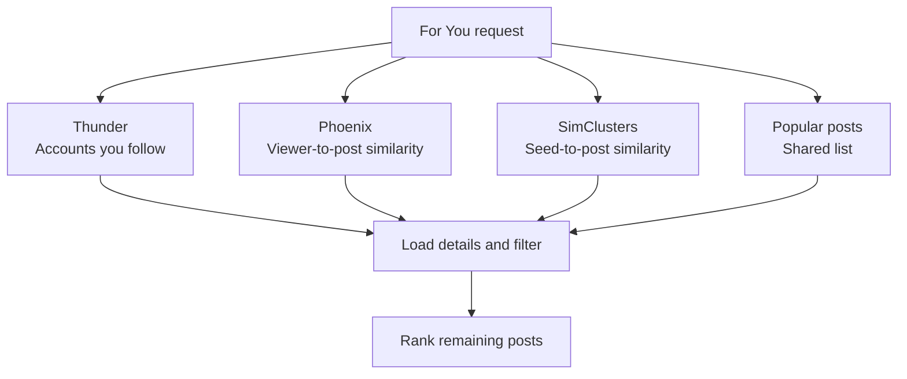
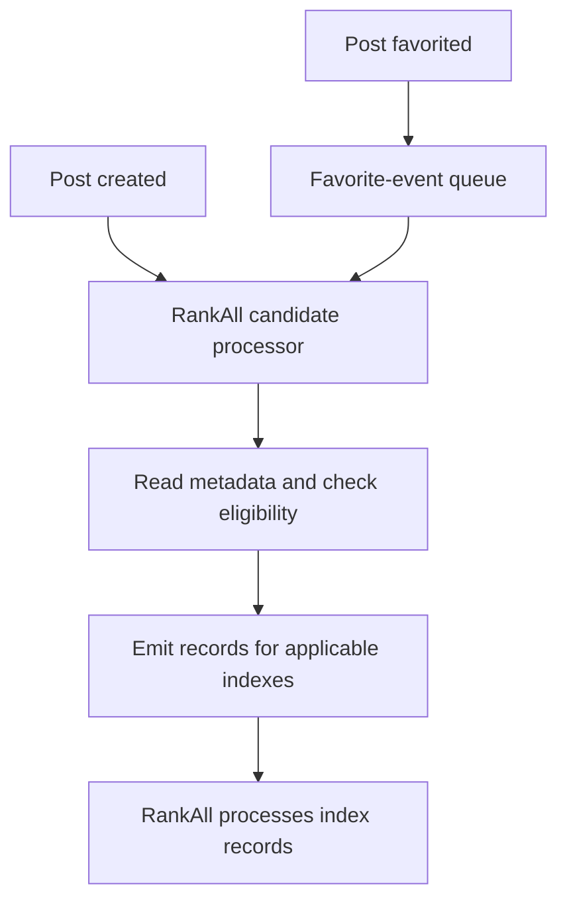

[Part 3](/blog/x-algorithm-part-3) followed two routes into For You. Thunder returned recent posts from accounts you follow. Phoenix retrieval searched for posts that matched a representation of your interests. In the newer public code, a third route can start from a specific post you engaged with, and a fourth can start from a shared list of popular posts. Each source gives the ranker a different set of candidates. [January source list](https://github.com/xai-org/x-algorithm/blob/aaa167b3de8a674587c53545a43c90eaad360010/home-mixer/candidate_pipeline/phoenix_candidate_pipeline.rs#L96-L97) · [November source list](https://github.com/xai-org/x-algorithm/blob/269340ce2eb8ca785bafa4f2c17a2e8b752bccd3/home-mixer/candidate_pipeline/phoenix_candidate_pipeline.rs#L387-L397)

## The two releases that changed the public picture

In May, X published more of Home Mixer, including Phoenix variants for topics and mixture-of-experts retrieval, plus the components that add items such as ads and Who to Follow. It also shipped a small Phoenix checkpoint and a combined retrieval-to-ranking inference demo. The August update then added SimClusters, a larger view of the Phoenix training and serving code, and the systems that produce and act on visibility labels. This article follows the public code through November 21, 2026. [May 15 release notes](https://github.com/xai-org/x-algorithm/blob/e414c171ed68266341193330bc4864bf3f3534e3/README.md#updates--may-15th-2026) · [August 13 release notes](https://github.com/xai-org/x-algorithm/blob/269340ce2eb8ca785bafa4f2c17a2e8b752bccd3/README.md#august-13th-2026) · [November 21 snapshot](https://github.com/xai-org/x-algorithm/commit/269340ce2eb8ca785bafa4f2c17a2e8b752bccd3)

## Four routes into the candidate pool

Figure 1 shows four of the sources registered in Home Mixer. The pipeline fetches candidates from enabled sources in parallel. It then loads missing post details, runs pre-scoring filters such as duplicate removal, and passes the remaining posts to the scorers. Each source can decide whether it applies to the request. [Registered sources](https://github.com/xai-org/x-algorithm/blob/269340ce2eb8ca785bafa4f2c17a2e8b752bccd3/home-mixer/candidate_pipeline/phoenix_candidate_pipeline.rs#L387-L397) · [Parallel fetch](https://github.com/xai-org/x-algorithm/blob/269340ce2eb8ca785bafa4f2c17a2e8b752bccd3/candidate-pipeline/candidate_pipeline.rs#L306-L319) · [Fetch, load, filter, and score](https://github.com/xai-org/x-algorithm/blob/269340ce2eb8ca785bafa4f2c17a2e8b752bccd3/candidate-pipeline/candidate_pipeline.rs#L142-L155) · [Duplicate filter](https://github.com/xai-org/x-algorithm/blob/269340ce2eb8ca785bafa4f2c17a2e8b752bccd3/home-mixer/candidate_pipeline/phoenix_candidate_pipeline.rs#L434-L439)



_Figure 1: Four paths into the candidate pool. Posts from different sources go through the same pre-scoring pipeline._

The popular-posts source reads the top entries from a shared cache and drops IDs already marked as seen. If it reads posts `301`, `302`, and `303` and the viewer has seen `302`, it returns `301` and `303` in that order. Home Mixer also registers cached candidates, Tweet Mixer, a semantic-ID source, and Phoenix variants for topics and mixture-of-experts retrieval. [Popular-posts cache and seen-ID filtering](https://github.com/xai-org/x-algorithm/blob/269340ce2eb8ca785bafa4f2c17a2e8b752bccd3/home-mixer/sources/popular_posts_source.rs#L27-L62) · [Full source list](https://github.com/xai-org/x-algorithm/blob/269340ce2eb8ca785bafa4f2c17a2e8b752bccd3/home-mixer/candidate_pipeline/phoenix_candidate_pipeline.rs#L387-L397)

## A post you liked can become a search query

Phoenix retrieves posts using a representation of the viewer. SimClusters starts with individual posts from the viewer's recent explicit or implicit engagement signals. It orders those signals by most recent engagement and keeps each seed ID once. For each eligible seed, it can use cached matches or query a service for nearby post vectors. Home Mixer applies a score cutoff and a per-seed limit before merging the lists. [Phoenix request](https://github.com/xai-org/x-algorithm/blob/269340ce2eb8ca785bafa4f2c17a2e8b752bccd3/home-mixer/sources/phoenix_source.rs#L113-L145) · [SimClusters cache and search](https://github.com/xai-org/x-algorithm/blob/269340ce2eb8ca785bafa4f2c17a2e8b752bccd3/home-mixer/sources/simclusters_source.rs#L64-L117) · [Seed selection](https://github.com/xai-org/x-algorithm/blob/269340ce2eb8ca785bafa4f2c17a2e8b752bccd3/home-mixer/sources/simclusters_source.rs#L288-L330) · [Per-seed limits](https://github.com/xai-org/x-algorithm/blob/269340ce2eb8ca785bafa4f2c17a2e8b752bccd3/home-mixer/sources/simclusters_source.rs#L222-L252)

Suppose you liked a bicycle repair post after reposting a commuter train post. Assume both seeds qualify and these made-up matches have passed the score cutoff and per-seed limit. The numbers are post IDs.

```text
Bike repair seed:     101, 102, 104
Commuter train seed:  102, 103, 105
Merged order:        101, 102, 104, 103, 105
```

Read one result from each list in turn. The bike list contributes `101` and the train list contributes `102`. On the bike list's next turn, it also offers `102`. The code skips that duplicate and immediately tries the bike list again, so `104` comes before `103`. This is the order within the SimClusters source at the merge step. The later ranker scores the candidates together with posts from other sources. [Round-robin merge and duplicate retry](https://github.com/xai-org/x-algorithm/blob/269340ce2eb8ca785bafa4f2c17a2e8b752bccd3/home-mixer/sources/simclusters_source.rs#L337-L359) · [Pipeline scoring order](https://github.com/xai-org/x-algorithm/blob/269340ce2eb8ca785bafa4f2c17a2e8b752bccd3/candidate-pipeline/candidate_pipeline.rs#L142-L155)

## A post enters the retrieval index through events

The January demo in Part 3 searched a precomputed matrix of post embeddings. The newer code also shows how records reach the retrieval indexes. A post-creation handler calls the RankAll candidate processor directly. The favorite-event handler can publish a request to a queue, and a configured forwarder connects that queue to the same processor. Figure 2 follows the standard path for a post that passes its index eligibility checks. [Creation handler](https://github.com/xai-org/x-algorithm/blob/269340ce2eb8ca785bafa4f2c17a2e8b752bccd3/phoenix-rankall-strato/columns/phoenix_rank_all/postCreationEventProcessor.strato#L5-L14) · [Favorite-event publishing](https://github.com/xai-org/x-algorithm/blob/269340ce2eb8ca785bafa4f2c17a2e8b752bccd3/phoenix-rankall-strato/columns/favoriteEventProcessor.strato#L125-L145) · [Favorite-event forwarder](https://github.com/xai-org/x-algorithm/blob/269340ce2eb8ca785bafa4f2c17a2e8b752bccd3/phoenix-rankall-strato/stream_forwarders/favoritePhoenixIndexingEventForwarder.strato#L3-L17)



_Figure 2: How a post can reach a retrieval index. Creation and favorite events take different routes into the processor and can produce records for different indexes._

Take an original bicycle repair post. When the creation request passes the checks in this path, the processor calls `buildPostCreationIndex`. A later qualifying favorite request for the same post goes through the favorite branch, which can emit records for other indexes. Phoenix can consider the post when a retrieval request searches an index that contains it. The index update and the feed refresh happen on separate paths. [Metadata lookup](https://github.com/xai-org/x-algorithm/blob/269340ce2eb8ca785bafa4f2c17a2e8b752bccd3/phoenix-rankall-strato/columns/phoenix_rank_all/phoenixRankAllCandidateProcessor.strato#L503-L524) · [Eligibility and index routing](https://github.com/xai-org/x-algorithm/blob/269340ce2eb8ca785bafa4f2c17a2e8b752bccd3/phoenix-rankall-strato/columns/phoenix_rank_all/phoenixRankAllCandidateProcessor.strato#L545-L598) · [RankAll record processing](https://github.com/xai-org/x-algorithm/blob/269340ce2eb8ca785bafa4f2c17a2e8b752bccd3/phoenix-rankall/src/processor/main_processor.rs#L28-L66)

## November adds a per-dataset retrieval limit

The November 21 diff lets Home Mixer send a map of dataset names to top-K values with a Phoenix request. Here, K is the requested candidate limit for a named dataset. The parser reads comma-separated `name=number` entries. For example, using made-up dataset names:

```text
Configured string:  example_a=30, example_b=10, example_c=oops
Request map:        example_a -> 30, example_b -> 10
```

The parser skips `example_c` because its value is non-numeric. The checked-in empty string produces an empty override map. These values describe the outgoing request. The number of posts that reach the viewer also depends on returned inventory, scoring, and filtering. [Checked-in default](https://github.com/xai-org/x-algorithm/blob/269340ce2eb8ca785bafa4f2c17a2e8b752bccd3/home-mixer/params/param.rs#L22-L27) · [Request call](https://github.com/xai-org/x-algorithm/blob/269340ce2eb8ca785bafa4f2c17a2e8b752bccd3/home-mixer/sources/phoenix_source.rs#L126-L142) · [Dataset limit parser](https://github.com/xai-org/x-algorithm/blob/269340ce2eb8ca785bafa4f2c17a2e8b752bccd3/home-mixer/sources/phoenix_source.rs#L168-L175) · [Protocol field](https://github.com/xai-org/x-algorithm/blob/269340ce2eb8ca785bafa4f2c17a2e8b752bccd3/phoenix/crates/serving/xai-recsys-proto/proto/recsys.proto#L365-L369)

The same diff tags results from two AI-video dataset types with a shared served type. Home Mixer can then record how those candidates fare at selection. The public commit documents the hook and metrics, while deployment configuration determines which requests use them. [Dataset-to-served-type mapping](https://github.com/xai-org/x-algorithm/blob/269340ce2eb8ca785bafa4f2c17a2e8b752bccd3/home-mixer/sources/phoenix_source.rs#L177-L187) · [AI-video source metrics](https://github.com/xai-org/x-algorithm/blob/269340ce2eb8ca785bafa4f2c17a2e8b752bccd3/home-mixer/side_effects/scored_stats_side_effect.rs#L636-L652)

By the time Phoenix ranks a request, source selection and index eligibility have already shaped what it can consider. [Part 7](/blog/x-algorithm-part-7) follows the learning objectives behind the two stages, including what changes when retrieval starts looking for posts a viewer is likely to spend time reading.
