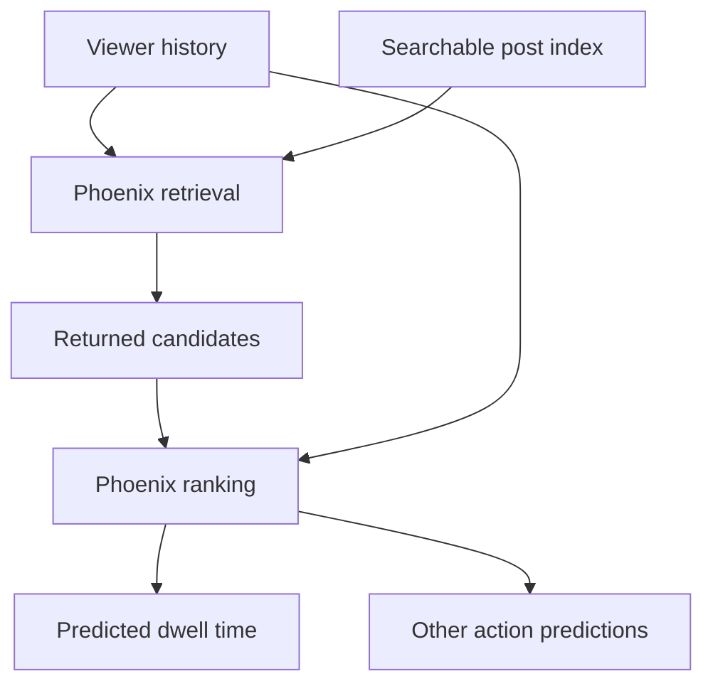
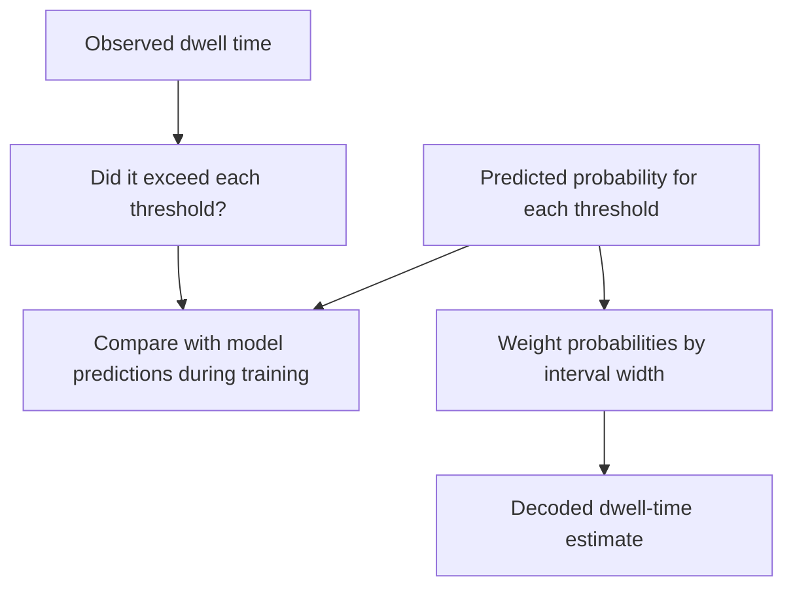

A post can hold your attention even if you scroll past it without liking or replying. The public Phoenix updates give us two ways to follow that signal through For You. Retrieval can learn to bring those posts into the candidate pool. Ranking can estimate how long you might spend on a post that has already made it into the pool. The two models learn different targets and affect different steps. [October release notes](https://github.com/xai-org/x-algorithm/blob/269340ce2eb8ca785bafa4f2c17a2e8b752bccd3/README.md#october-13th-2026) · [November 21 snapshot](https://github.com/xai-org/x-algorithm/commit/269340ce2eb8ca785bafa4f2c17a2e8b752bccd3)

## From a model demo to a training workflow

[Part 4](/blog/x-algorithm-part-4) used the January code to examine the ranking transformer and the attention mask that isolates candidates. In May, X published a mini checkpoint and one script that ran retrieval and ranking in sequence. The August update opened more of the training lifecycle. The published quickstart generates synthetic sessions, trains separate retrieval and ranking checkpoints, and passes the candidates returned by the retrieval service to the ranking service for the same viewer history. The documented run uses three synthetic sessions to test that handoff. [May 15 release notes](https://github.com/xai-org/x-algorithm/blob/e414c171ed68266341193330bc4864bf3f3534e3/README.md#updates--may-15th-2026) · [Synthetic data and ranking training](https://github.com/xai-org/x-algorithm/blob/269340ce2eb8ca785bafa4f2c17a2e8b752bccd3/phoenix/QUICKSTART.md#L32-L58) · [Retrieval training](https://github.com/xai-org/x-algorithm/blob/269340ce2eb8ca785bafa4f2c17a2e8b752bccd3/phoenix/QUICKSTART.md#L106-L117) · [Retrieve-then-rank smoke test](https://github.com/xai-org/x-algorithm/blob/269340ce2eb8ca785bafa4f2c17a2e8b752bccd3/phoenix/QUICKSTART.md#L153-L170)

Figure 1 shows where the two models act when serving a request. A retrieval score determines which posts make it into the candidate pool. A dwell-time prediction is one input to scoring posts that have already reached ranking.



_Figure 1: Two places attention can affect For You. A saved training checkpoint serves each stage in the synthetic Phoenix quickstart._

## Retrieval can learn from a dwell event

X's October 13 note describes an objective for surfacing posts people read all the way through. The pinned code shows how to attach an `ld` head, a model output trained for a specific target. One published configuration uses a favorite as the positive action for the home head and `CLIENT_TWEET_RECAP_DWELLED` for the `ld` head. The training loop calculates a loss for each head using its action lists. The action name identifies the event used for training. The release note describes the product intent, while the linked code defines the training signal. [October 13 announcement](https://github.com/xai-org/x-algorithm/blob/269340ce2eb8ca785bafa4f2c17a2e8b752bccd3/README.md#october-13th-2026) · [Favorite and dwell targets](https://github.com/xai-org/x-algorithm/blob/269340ce2eb8ca785bafa4f2c17a2e8b752bccd3/phoenix/xrex/configs/xrecsys_two_tower.py#L281-L297) · [Per-head training loss](https://github.com/xai-org/x-algorithm/blob/269340ce2eb8ca785bafa4f2c17a2e8b752bccd3/phoenix/xrex/models/recsys_two_tower_model.py#L2880-L2914)

Here is a simplified example of the multi-slot retrieval path. Suppose there is one candidate slot left and two posts have the following made-up similarity scores. Use a weight of 1.0 for the favorite objective and 0.75 for dwell. The code can blend scores across the slots before picking candidates.

```text
                       Favorite   Dwell    Blended retrieval score
Quick update               0.80    0.10    0.80 + 0.75 × 0.10 = 0.875
Long explainer             0.50    0.65    0.50 + 0.75 × 0.65 = 0.9875
```

The quick update leads on the favorite score alone. With the dwell signal included in this example, the explainer takes the slot and the ranking model gets a chance to score it. The example isolates the arithmetic and uses invented similarity scores. The request and model configuration determine which blend applies. [Weighted slot scoring](https://github.com/xai-org/x-algorithm/blob/269340ce2eb8ca785bafa4f2c17a2e8b752bccd3/phoenix/xrex/models/recsys_two_tower_model.py#L150-L175) · [Slot weights for a retrieval request](https://github.com/xai-org/x-algorithm/blob/269340ce2eb8ca785bafa4f2c17a2e8b752bccd3/phoenix/xrex/models/recsys_two_tower_model.py#L2424-L2433)

## Ranking estimates time with a series of thresholds

The October 8 update reported improved time-spent prediction. In the published ranking code, the CREAD dwell-time head learns a series of binary targets. Each one asks whether the observed dwell exceeded a particular threshold. The loss measures both those binary predictions and the error in the decoded duration. The home-feed configuration defines 30 logarithmically spaced thresholds from 2 to 120 seconds for this head. Figure 2 shows how the training targets and the serving estimate relate. [October 8 announcement](https://github.com/xai-org/x-algorithm/blob/269340ce2eb8ca785bafa4f2c17a2e8b752bccd3/README.md#october-8th-2026) · [Threshold spacing](https://github.com/xai-org/x-algorithm/blob/269340ce2eb8ca785bafa4f2c17a2e8b752bccd3/phoenix/xrex/models/loss_recsys.py#L110-L125) · [Training targets and loss](https://github.com/xai-org/x-algorithm/blob/269340ce2eb8ca785bafa4f2c17a2e8b752bccd3/phoenix/xrex/models/loss_recsys.py#L153-L170) · [Dwell head configuration](https://github.com/xai-org/x-algorithm/blob/269340ce2eb8ca785bafa4f2c17a2e8b752bccd3/phoenix/xrex/configs/xrecsys.py#L919-L933)



_Figure 2: A single dwell observation trains several threshold predictions. The serving path combines predicted probabilities into one duration using interval widths when power and scale are both one._

Table 1 works through three example thresholds. If a training example has an observed dwell of 8 seconds, it exceeds 2 and 5 seconds. At serving time, use the probabilities in the fourth column for a separate example prediction. With power and scale set to one, each contribution is the probability multiplied by the width from the previous threshold, starting from zero. The estimated dwell time is the sum, **4.6 seconds**. [Sigmoid and duration reconstruction](https://github.com/xai-org/x-algorithm/blob/269340ce2eb8ca785bafa4f2c17a2e8b752bccd3/phoenix/xrex/models/recsys_model.py#L3733-L3755)

**Table 1: Worked dwell-time decode.** The thresholds and probabilities are illustrative. The training labels use an observed dwell of 8 seconds, and the last column shows how a set of serving predictions becomes a duration.

| Threshold | Training target | Interval width | Example probability | Contribution |
| --------- | --------------- | -------------- | ------------------- | ------------ |
| 2 s       | Yes             | 2 s            | 0.90                | 1.8 s        |
| 5 s       | Yes             | 3 s            | 0.60                | 1.8 s        |
| 15 s      | No              | 10 s           | 0.10                | 1.0 s        |
| **Total** |                 |                |                     | **4.6 s**    |

## November adds a way to learn from another model

The November 21 commit adds a ranking variant that can transform its output embeddings before making action predictions. It also supports distillation, where a student model learns from a teacher model's predictions. The training hook can use the usual action predictions or an optional separate head. The loss accepts teacher probabilities and can use them as soft targets or convert them to logits, the raw scores before conversion to probabilities. [Output transformation and optional head](https://github.com/xai-org/x-algorithm/blob/269340ce2eb8ca785bafa4f2c17a2e8b752bccd3/phoenix/xrex/models/recsys_overarch_model.py#L158-L176) · [Distillation training hook](https://github.com/xai-org/x-algorithm/blob/269340ce2eb8ca785bafa4f2c17a2e8b752bccd3/phoenix/xrex/models/recsys_overarch_model.py#L231-L263) · [Loss options](https://github.com/xai-org/x-algorithm/blob/269340ce2eb8ca785bafa4f2c17a2e8b752bccd3/phoenix/xrex/models/recsys_distillation_loss.py#L25-L39)

Suppose a training row has a teacher like probability of 0.80 and a missing reply probability. If both actions are otherwise eligible for the loss, the row contributes the 0.80 target for the like head. The missing reply target contributes zero to the distillation loss because the code masks it out. The coverage calculation counts a row that has at least one teacher target, so this row can count as covered even with the missing reply prediction. [Missing targets and coverage](https://github.com/xai-org/x-algorithm/blob/269340ce2eb8ca785bafa4f2c17a2e8b752bccd3/phoenix/xrex/models/recsys_distillation_loss.py#L29-L46)

Phoenix still produces predictions that Home Mixer has to turn into an ordering. In Part 8, we'll follow those predictions through the value model and explain why the order can change again before the feed reaches the screen.
